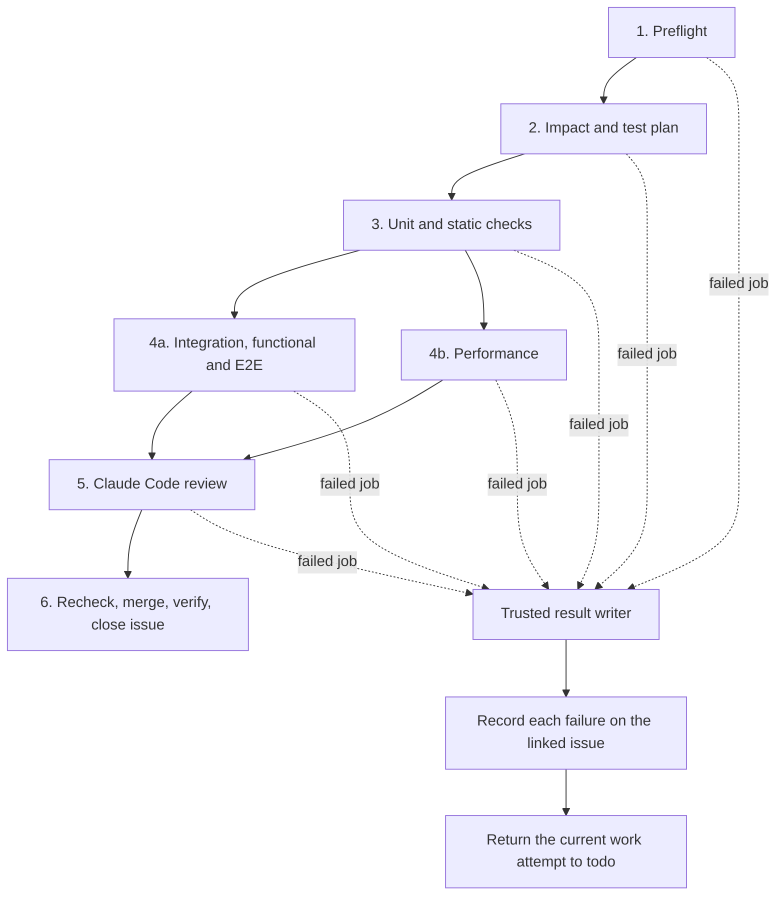

# Normal development pipeline

Standard ID: **DEV-PIPELINE-1**. Owner: **faberline/aw**.
Design approved: **2026-10-30**. State: **candidate; enforcement and consumer
adoption pending**. A document, a green writer job, or an adoption issue does
not prove that a repository conforms.

## Scope

This standard defines the pull request pipeline for normal development.
AW owns the standard and shared control code. Product repositories own their
test commands, test content, and acceptance criteria. They link to this file
at the reviewed AW revision used by their pipeline. They do not maintain a
second copy of this standard.

The first adoption set is `faberline/core`, `faberline/lumen`,
`faberline/keep`, `faberline/tape`, `faberline/defer`, and `faberline/relay`,
in that order. Other Faberline product repositories adopt the same contract
through a repository-specific issue and verified configuration.

**AW itself does not require Claude Code review.** Do not add a Claude check
to AW's CI or branch requirements because of this standard. Keep AW's other
applicable CI and review requirements. Claude review in stage 5 is required
for the six product repositories listed above.

Release, RC tags, version selection, release-wide test matrices, publication,
and milestone closure are out of scope. This standard changes no release
workflow, schedule, cloud resource, or quota. Merging a development PR proves
only that PR's acceptance. It does not prove a release or milestone complete.

## Invariants

- Keep every existing applicable test, feature row, functional/E2E assertion,
  performance workload, and numeric threshold. Do not weaken a gate to make
  adoption pass.
- All evidence binds the repository, PR, exact PR commit, exact base commit,
  issue contract, reviewed selection policy, workflow identity, and run
  attempt. A result for another input is historical evidence.
- Only completed successful required jobs count as passed. Missing, skipped,
  cancelled, neutral, zero-test, or unknown evidence does not count.
- The ordinary test jobs have no issue, merge, or policy-writing permission.
  A single trusted result writer owns issue comments, lifecycle changes, and
  merge decisions. Its work is not evidence that product tests passed.
- Read the selection and completion rules from a reviewed, protected version.
  A PR cannot authorize its own weaker rules. Preserve the separate adoption
  checks for protected workflow and policy changes.
- Preserve active owners, leases, worktrees, and unrelated work. An agent
  repairs the existing PR and branch after it receives a returned issue.

## Six stages

Stages run in order. A stage starts only after every applicable required
job in the previous stage passes. A stage can contain a matrix of jobs.
The stage names do not limit coverage or the number of feature rows.

### 1. Preflight

Use one job with three checks. Read one PR snapshot and freeze the exact PR
and current `main` commits for the run.

1. Check whether the PR includes the frozen current `main` commit. A PR
   behind `main` fails and returns its linked issue to `todo`.
2. Check whether the PR can merge without a conflict. A confirmed conflict
   fails and returns its linked issue to `todo`.
3. Require exactly one canonical linked issue. It must be a real open issue,
   not a PR number or an incidental text reference. Bind its repository,
   number, and current acceptance contract. Reject zero or ambiguous links.

Use the configured default target branch; the first adoption set uses
`main`. A draft, closed PR, unsupported source, wrong target, unreadable
issue, or missing acceptance contract cannot advance. Keep the existing
supported-source and protected-change restrictions.

An API error or unresolved mergeability is not proof of a conflict or a
fresh branch. Retry bounded read errors. If the job ends in failure, report
the actual query failure through the failure contract below.

### 2. Impact and test plan

Use one planning job. Calculate the PR's changes between its merge base and
the frozen PR commit. Use immutable commits, not a new lookup of the moving
`main` name in each job. Retain file additions, deletions, and both paths of
a rename. Read every page of changed files; never silently truncate a plan.

Produce a machine-readable plan with:

- Changed paths and the exact comparison commits.
- Affected packages and their transitive users inside the repository.
- Required unit, static, documentation, integration, functional/E2E, and
  performance checks, including every required target and feature row.
- The source issue's acceptance checks, added to the path-selected checks.
- Expected nonzero test rosters and the reason for each applicability choice.
- A stable digest that every later job includes in its evidence.

Changes to shared libraries, dependencies, build configuration, test
selection, workflows, or policies can require a wider scope. Existing
broader required gates remain required until a separately reviewed complete
replacement proves coverage. A smaller path list alone does not permit a
smaller test set.

An unmapped path or unknown dependency cannot silently select no tests.
Use the already approved full fallback, or fail with the missing decision.
An explicit not-applicable decision must come from reviewed policy, name
the category, and explain the reason. It never removes another applicable
check. An unplanned skip is not a not-applicable decision.

Missing test content remains an issue-planner task. Record the exact gap
and its acceptance need so the planner can create a bounded follow-up.
The pipeline does not invent a passing test, hide the failure, or waive the
original requirement while it waits for that content.

### 3. Unit and static checks

Execute the required unit tests and static checks from the plan. For Rust,
retain applicable formatting, Clippy, compilation, documentation examples,
package targets, and feature checks. One logical stage can expand into
several jobs to keep failures separate and bound runtime.

Check the actual selected and executed test names against the expected
roster. A command that exits zero with zero selected tests is a failure.
Compilation without execution does not prove test success. Do not drop
existing tests, ignore failures, or change thresholds to pass this stage.

### 4. Integration, functional/E2E, and performance

Use two logical job groups after stage 3:

1. Run the selected integration, functional, and E2E checks.
2. Run the selected performance checks with their original workloads and
   thresholds.

The two groups can run in parallel only with resource isolation that keeps
one from changing the other's measurements or fixtures. Otherwise serialize
them. Keep the approved cloud runtime and required topology for each test.
Do not substitute a local result or an empty smoke test for required cloud
acceptance. A stage can be not applicable only under the reviewed plan rules
above, with an explicit passing applicability receipt.

### 5. Claude Code review

Start paid review only after stages 1 to 4 have complete required success
evidence for the same inputs. Check the current PR again before review.

The independent reviewer checks the implementation, source issue acceptance,
and test evidence. It returns an authenticated decision bound to the exact
PR/base commits and plan. A successful workflow with no valid review result
is not a PASS. A negative review and a review setup/tool failure must remain
different failure reasons; both use the failed-job reporting contract.

Keep review read-only. Never execute PR programs or scripts in a runner that
holds review credentials or lifecycle-write credentials. The reviewer does
not merge, close issues, or change lifecycle labels.

### 6. Recheck, merge, verify, close issue

The trusted completion job must perform these steps in order:

1. Read the current PR, current base, issue contract, plan, required test
   results, and authenticated review. Require the same reviewed inputs.
2. Recheck freshness, mergeability, source/target, and provider requirements.
   Main or PR movement invalidates evidence for the old input. A PR now
   behind or in conflict returns to `todo`; it does not bypass preflight.
3. Request merge of that exact PR commit through the protected provider
   path. Retain strict branch rules and the required verified-merge check.
4. Read back the actual merge. An accepted auto-merge request or queue entry
   is not a completed merge.
5. Close only the canonical issue after the merge is confirmed, unless the
   provider already closed it. Read back the issue's closed state.

Do not close an issue before its PR merges. Keep a recovery record across
partial writes. If merge succeeded and issue closure failed, retry closure
only. Never return an already merged delivery to `todo`. An unknown merge
outcome requires a fresh read before any retry or lifecycle change.

Stage 6 is exempt from the blanket failed-job-to-todo rule below. It still
records its error and recovery state. A completion API outage is not a new
product defect, and cannot undo a confirmed merge.

## Every failed job reports to the issue

**Every failed job in stages 1 to 5 must record its failure, post a comment
to the canonical issue, and return the current work attempt to `todo`.**
This includes preflight, planning, static, unit, every expanded matrix job,
integration, functional/E2E, performance, review admission, and Claude review
jobs. Setup, checkout, provisioning, dependency, timeout, and infrastructure
failures are included. Do not wait for the final merge stage to do this.

The reporting path runs even when upstream jobs fail or are skipped. A final
job that runs only after success cannot be the only failure reporter. Use
trusted job/run metadata and reconcile completed failed jobs when a runner
cannot upload its own receipt. A log upload failure must not erase the
original job failure.

### Failure record and comment

Retain one record per failed expanded job and run attempt. Include:

| Field | Required content |
|---|---|
| Identity | Repository, PR number, canonical issue, PR commit and frozen base commit |
| Producer | Workflow path and trusted revision, run ID, attempt, job ID, stage and matrix values |
| Failure | Failed step/check, category, concise reason, actual observed result and required result |
| Evidence | Direct run/job links, retained diagnostic location, and plan digest if planning completed |
| Follow-up | What the repairing agent must do, or the exact missing test content for the planner |
| State | Whether this is the current work attempt, a historical failure, or a pending write recovery |

Do not claim a root cause when the available evidence only shows a symptom.
If logs cannot be read, say so and retain the known failed step and job link.
Remove secrets and sensitive output before posting excerpts. A structured
receipt by itself is insufficient: the human-readable issue comment must
contain the reason and evidence links.

Post each distinct failed job once. Repeated delivery of the same event must
not repeat its comment. A different matrix row, job, or run attempt retains
its own failure record; one failure must not hide another. A suitable comment
identity binds repository, PR, head, run ID, attempt, and expanded job ID.

The result writer then adds `todo`, removes conflicting lifecycle labels
only after it verifies the desired state, and reads back the result. Keep
unrelated labels. A comment or label API failure remains retryable; it must
not be reported as a completed handoff.

### Ownership and retries

Many jobs can fail for the same submitted work. Record every failure, but
return that work attempt only once. If an agent has already claimed the
returned `todo`, later failures from the old attempt must not change that
agent's new `doing` state, release its lease, or create another worktree.
Record those failures as historical context instead. Likewise, an old head's
failure must not reset a newer submission. Recheck head, contract, work
attempt, and issue state before every lifecycle write.

This is an idempotent handoff: retrying it completes the original action
without creating a second assignment. Keep the existing serialized writer,
ownership guard, and durable comment/label recovery journal. Do not add a
second privileged writer just to attach per-job comments.

A cancelled superseded run and a job skipped because an earlier job failed
are not new failed jobs. They never count as success. Explain the upstream
failure without creating a false independent test failure. An unexpected
cancellation that leaves required evidence incomplete blocks completion.

If preflight finds no canonical issue, or several possible issues, it cannot
safely post to an issue. Post the exact linking error on the PR instead,
block later stages, and ask for the link to be fixed. Do not choose a random
issue, mutate all possible issues, or create a replacement issue automatically.

An actual cloud quota failure is an infrastructure failure. Identify its
project, service, quota metric and region from the real error. Read available
usage and limits, then include the corresponding Cloud Console request link.
The user submits any increase; the pipeline does not submit it for them.

## Wakes and trust

PR updates start a new frozen-input run. A change to the source issue's
acceptance contract also invalidates evidence for the old contract. A main
update must trigger a bounded recheck of open PR freshness, so a quiet stale
PR does not retain a misleading approval forever. This recheck need not
start expensive tests or paid review for an ineligible PR.

Result writers serialize per repository and reconcile the full paginated
managed queue. Inspect current run attempts and all expanded jobs; a replaced
pending wake must not lose another PR's failure. Every job/run event is a
hint to read current evidence, not permission to trust its old payload.

Publish a stable completion gate from the trusted writer for branch rules.
It passes only after the required stages and independent review qualify the
current inputs. The test or review job cannot forge this gate. Do not grant
branch-protection bypass to work around an incomplete rollout.

## Adoption and proof

The [development adapter](../../plugins/faberline/skills/issue-ci/DEVELOPMENT-PIPELINE.md)
documents the shared metadata/DAG checks and per-job failure reporting.
Its publication does not activate a consumer or waive its adoption proof.

Shared enforcement is tracked in
[faberline/aw#129](https://github.com/faberline/aw/issues/129). The issue remains
open until its implementation and conformance evidence pass; publishing this
document does not complete it.

AW first publishes this specification and shared implementation changes.
Each consumer then adopts an immutable reviewed AW revision through its own
issue. A documentation PR is not a deployed pipeline.

Before activation, retain executable conformance evidence for at least:

1. Fresh/behind/conflicting PRs; zero/one/multiple linked issues; unreadable
   metadata; and main movement during a run.
2. Changed, deleted and renamed paths; shared dependency users; full fallback;
   missing mappings; issue-required checks; and nonzero roster enforcement.
3. Actual stage ordering, required matrix expansion, original thresholds,
   and isolated functional/performance environments.
4. A failure in **each** stage 1 to 5 and in an expanded matrix row: reason
   retained, issue comment posted, and current attempt returned to `todo`.
5. Multiple failures, duplicate events, reruns, stale heads, and an agent
   claiming returned work: no lost reason, duplicate handoff, or stolen owner.
6. Partial comment/label writes and missing uploaded logs: recovery completes
   without assuming success or resetting a newer work attempt.
7. Exact-input authenticated Claude PASS/rejection/tool failure; required
   skipped/missing/cancelled evidence; and protected-policy changes.
8. Confirmed merge before closure; denied/unknown merge; duplicate completion;
   and a close failure after merge: retry closes only the correct issue.

The conformance checker and immutable workflow identities must be reviewed
with the consumer. Until the checker exists and that consumer's exact inputs
pass, report **adoption pending**, with the concrete remaining gap. Do not
claim active enforcement or clear existing holds from this document alone.

The exception path is the consumer's reviewed per-category applicability
policy, with explicit reasons and evidence. It cannot exempt stage order,
failure reporting, nonzero selected tests, existing applicable thresholds,
current-input review, ownership, or merge-before-close. Product gaps go to
the issue planner; they are not policy exceptions.

The per-repository rollout record must link the adoption issue, exact PR and
base commits, pinned AW revision, CI and review results, conformance evidence,
actual merge, and actual issue closure. Record pending and failed states
truthfully. Stage 5 remains excluded for AW itself.
