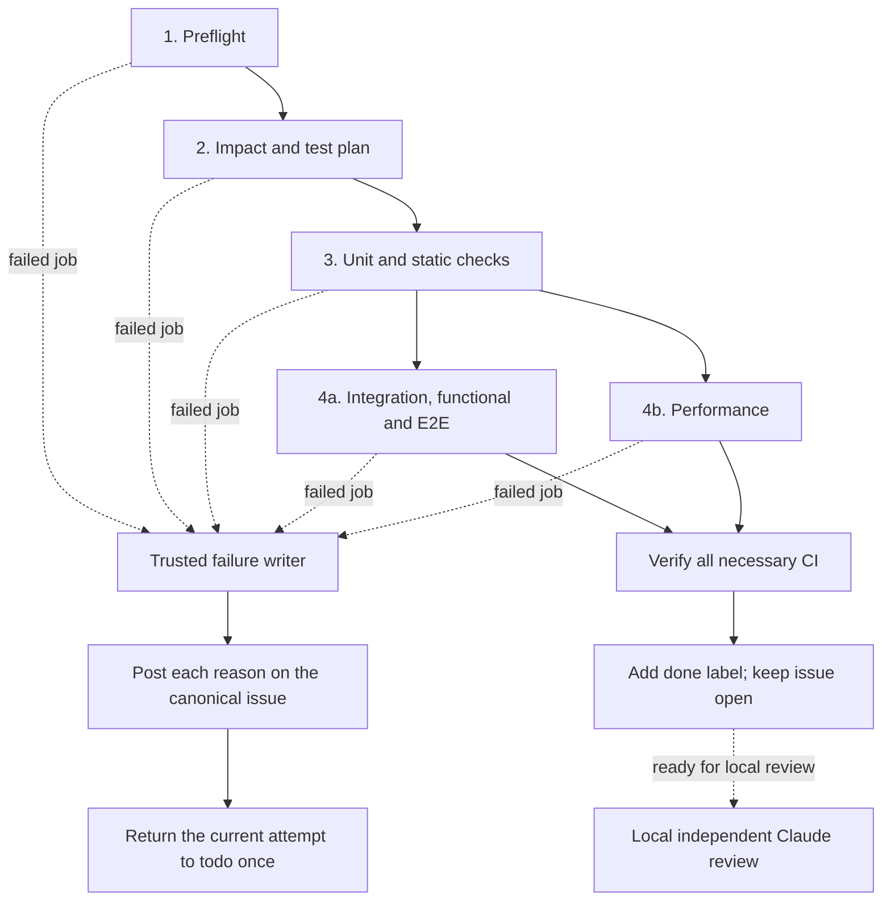

# Normal development pipeline

Standard ID: **DEV-PIPELINE-1**. Owner: **faberline/aw**.
Revision: **2026-10-31**. Consumer adoption remains pending until deployed
behavior and exact-input evidence prove this contract.

## Scope

This standard defines normal development PR tests. AW owns the stages, their
order and shared controls. Each product owns its job count, names, matrices,
batch layout, commands, test content and acceptance criteria. AW sets no fixed
job or batch count.

Deploy in this order: `faberline/core`, `faberline/lumen`, `faberline/keep`,
`faberline/tape`, `faberline/defer`, `faberline/relay`.

**CI ends after stage 4. Claude Code review runs locally.** Cloud CI must not
start review, merge a PR or close its issue. Remove the
old cloud review, native merge publisher and completion recovery entry points.
After all necessary current-input CI succeeds, add the `done` label and
remove conflicting `todo`/`doing` labels. Keep the issue OPEN for local
`issue-review`. `done` means CI passed and review is ready; it does not mean
merged, accepted or closed. GitHub search `label:done` selects this label.

**AW itself requires no Claude review**, locally or in cloud CI. Keep its
applicable CI, acceptance and other review requirements. The six products
retain independent Claude review after complete required CI, run locally.

Release, RC tags, versions, full release matrices, publication, milestone
closure, schedules, cloud resources and quota changes remain out of scope.
This revision replaces the earlier six-stage cloud completion design. The
historical guard-activation protocol is not a prerequisite for this pipeline.
Preserve existing leases, ledger records and unrelated work during retirement.

## Invariants

- Keep every existing applicable test, package/feature row, functional/E2E
  assertion, performance workload and numeric threshold.
- Bind evidence to the repository, PR, exact head and base, canonical issue
  contract, reviewed selection policy, workflow definition, run and attempt.
- Only completed successful required jobs count. Missing, skipped, cancelled,
  neutral, zero-test or unknown results never count as success.
- Test jobs have no lifecycle or merge permission. One trusted CI label writer
  posts job reasons and returns only the current failed work attempt to todo.
  After full required CI succeeds, it labels the open issue `done` for local
  review. It has no merge, closure or review authority.
- Read selection rules from a reviewed protected source. A PR cannot approve
  its own weaker policy. Local review must inspect protected changes and full
  coverage retention before a controller publishes them.
- Preserve active owners, leases, worktrees and WIP. A repair reuses the same
  PR and branch. Never reset another owner's work or infer ownership from age.

## Four CI stages

A stage starts only after all applicable required jobs in earlier stages pass.
Each stage may contain several jobs or batches.

The local review box is outside GitHub Actions. Merge and issue closure are
outside this DAG. The `done` label requires all necessary current-input tests
to pass. A green workflow or `done` label does not mean reviewed, merged or closed.

### 1. Preflight

Read one PR snapshot. Freeze its exact head and current default target commit.
The initial consumers use `main`.

1. Require the head to include that current main commit. Behind main fails.
2. Require a conflict-free merge. A confirmed merge conflict fails.
3. Require exactly one canonical real open issue and its acceptance contract.
   Incidental references, a PR number, no link or ambiguous links fail.

Reject a draft, closed PR, unsupported source, wrong target or unreadable
contract. Retry read errors only within a bounded policy. Unknown mergeability
is not proof of a conflict or freshness. Report the actual failed query when
it remains unknown. Main or PR movement invalidates the old snapshot.

### 2. Impact and test plan

Compare the frozen merge base and head. Retain additions, deletions and both
rename paths. Read every changed-file page. Never truncate a plan.

Produce a machine-readable plan with exact commits, changed paths, affected
packages and their transitive users, issue-required checks, all required
unit/static/docs/functional/E2E/performance targets and feature rows, expected
nonzero rosters, applicability reasons and a stable digest.

Shared libraries, dependencies, build configuration, workflows, selection or
policy changes can require broader coverage. Preserve existing broader gates
until a separately reviewed complete replacement proves retention. Unknown
paths or dependencies use the approved full fallback or fail with the missing
mapping. Never silently select zero tests. A reviewed explicit not-applicable
receipt names the category and reason and cannot remove another required check.

Missing test content belongs to the issue planner. Record the exact gap and
required acceptance. Do not invent a passing test, hide a failure or waive its
requirement while waiting for the planner.

### 3. Unit and static checks

Execute all planned unit and static work. For Rust, retain applicable format,
Clippy, compilation, documentation examples, package targets and features.
Jobs may run in parallel where safe. Verify selected and executed test names
against the expected roster. Zero executed tests fail. Compilation alone is
not execution. Keep all assertions and original thresholds.

### 4. Integration, functional/E2E and performance

After every stage 3 job passes, run two logical groups:

1. Selected integration, functional and E2E tests.
2. Selected performance workloads with their original thresholds.

Run the groups in parallel only when resources and fixtures are isolated.
Otherwise serialize them. Keep approved runtime, topology and required cloud
acceptance. A local smoke test cannot replace required cloud evidence. Any
not-applicable decision follows the reviewed stage 2 rules.

## Every failed CI job reports to the issue

Every failed job in stages 1 to 4 posts its observed reason and evidence on
the canonical issue. Then the writer returns the current attempt to todo.
Include preflight, planning, every matrix row/batch, setup, checkout,
dependencies, provisioning, timeout and infrastructure failures.

Run reporting despite failed or skipped upstream jobs. Reconcile trusted
GitHub job/run metadata when a failed runner cannot upload a receipt. Retain
one record for every distinct expanded job and run attempt. Include:

| Field | Required content |
| --- | --- |
| Identity | Repo, PR, canonical issue, exact head and frozen base |
| Producer | Workflow path/revision, run, attempt, job, stage, matrix/case identity |
| Failure | Failed step, category, concise reason, actual and required result |
| Evidence | Direct run/job links, retained diagnostics and plan digest when available |
| Follow-up | Repair needed or exact missing content for the issue planner |
| State | Current attempt, historical failure or pending write recovery |

Do not call a symptom a proven root cause. If logs are unavailable, retain
that fact, the failed step and job link. Remove secrets from excerpts. A
structured receipt without a readable reason comment is insufficient.

Deduplicate by repo, PR, head, run, attempt and expanded job. Different failed
jobs each retain a reason. Return one coding attempt only once. If a worker
already claimed returned todo, later failures add context and preserve its
new doing state and lease. Old-head failures cannot reset a newer submission.
Recheck head, contract, attempt and issue before each write. Preserve unrelated
labels and read back all writes. Partial or unknown writes stay retryable.

A superseded cancelled run or an upstream-induced skip is not a new failed
job. It never counts as success. An unexpected cancellation keeps necessary
evidence incomplete.

If no canonical issue exists or several match, post the exact link error on
the PR. Choose no issue and change no issue labels. An actual cloud quota
failure includes the confirmed project, service, metric, region, available
usage/limit and Console request link. The user submits any quota increase.

## Local review and completion

Independent Claude review starts locally only after all required CI for the
current inputs succeeds. It reads the issue, diff, source and CI evidence.
It runs no candidate program, build or test with review credentials. Preserve
an exact-head/base/issue/plan/CI-run receipt and the actual reviewer identity.
A tool failure, negative decision, missing receipt or stale input cannot pass.

A `done` label never bypasses the local reviewer's independent current-head
CI check. Review failure records every reason. The authorized local controller returns
only the current failed attempt to todo, with the same owner and retry checks.
A later worker claim or newer head must not be reset.

Only the authorized local controller may finish delivery. It rechecks current
head, main, issue contract, complete required CI, local independent review and
provider rules. It confirms the actual exact-head merge before closing only
the canonical issue. Read back closure. If merge succeeded and closure failed,
retry closure only. Never return a confirmed merged delivery to todo.

This standard does not start a local schedule or grant a reviewer new merge
permission. Use existing user authorization and role boundaries. Cloud CI
must not perform these completion steps or publish a review/merge gate.

## Wakes and adoption proof

PR changes start new frozen-input tests. Issue contract changes invalidate old
evidence. Main updates trigger a bounded freshness recheck of the full open
queue. It does not start paid review for stale or otherwise ineligible work.
The failure writer serializes per repo, reads complete pages and current run
attempts, and reconciles displaced wakes. An event is a hint to read current
state, never authority to trust its payload.

Opt in with `completion_owner: "local"` in reviewed consumer policy. Remove
cloud review, native merge and completion recovery producer configuration.
CI success labels the open issue `done`; failure records reasons and returns
only the current work attempt to `todo`. Keep all coverage blockers until
actual required evidence resolves them. Keep strict base
and the complete required test checks in branch rules. Retire the old
`claude/verified-merge` cloud status requirement only with the test-check
replacement and actual local review path ready. Never bypass failed tests.

Before calling a consumer adopted, retain executable evidence for:

1. Fresh/behind/conflicting PRs, canonical-link errors, read errors and main movement.
2. Complete renamed/deleted/changed paths, dependency users, fallback, issue checks and nonzero rosters.
3. Real stage order, full matrices, original bounds and isolated expensive tests.
4. Every CI stage and expanded-job failure reason, issue comment and current-attempt todo return.
5. Multiple/duplicate failures, reruns, stale inputs and later worker ownership.
6. Partial writes and missing logs, without lost reasons or stolen work.
7. Qualified CI labels the open issue `done`; local exact-input review handles
   PASS/rejection/tool failure, with no cloud review.
8. Local verified merge-before-close and close-only retry, with no cloud merge/closure entry point.

Keep pending or failed states explicit. Green controller work or a standard
document does not prove product acceptance. AW #129 tracks shared enforcement;
the six repository-specific adoption issues track deployed acceptance.
